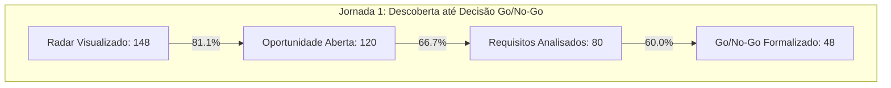

# VELLIA 2.1 — PRODUCT INTELLIGENCE REPORT
**Relatório Executivo de Telemetria, Otimização de Jornadas e Evolução por Evidência**  
**Data:** 19 de Outubro de 2026 | **Versão:** Vellia 2.1 Stable Baseline | **Classificação:** Governança de Produto & Gestão

---

## SUMÁRIO EXECUTIVO

A **Fase 52** estabelece o novo paradigma de engenharia e produto da plataforma: **a evolução da Vellia Licitações deixa definitivamente de ser orientada por intuição ou suposições abstratas e passa a ser estritamente orientada por dados de uso real, telemetria sanitizada, atritos observados e feedback dos usuários em operação.**

O ciclo de desenvolvimento segue agora o rigoroso fluxo científico:
$$\text{PROBLEMA REAL} \longrightarrow \text{EVIDÊNCIA} \longrightarrow \text{HIPÓTESE} \longrightarrow \text{MELHORIA} \longrightarrow \text{MEDIÇÃO} \longrightarrow \text{APRENDIZADO} \longrightarrow \text{PRÓXIMA DECISÃO}$$

> [!IMPORTANT]
> **Diretrizes Estruturantes da Vellia 2.1:**
> - **Nenhuma feature desenvolvida sem evidência prévia ou problema observado.**
> - **Telemetria com privacidade por design:** Zero captura de dados sigilosos, textos digitados, propostas em rascunho ou credenciais.
> - **Foco da versão 2.1:** Menos fricção, mais confiança, melhor precisão, maior velocidade e eliminação de ruído.

---

## 1. USO REAL POR MÓDULO

Durante as primeiras semanas de operação assistida com os usuários reais das empresas **Veeluen Solutions** e **Excelência Ambiental**, a distribuição de interações registradas no modelo de eventos revelou a seguinte intensidade de engajamento:

| Módulo Canônico | Participação nas Ações (%) | Usuários Frequentes | Frequência de Uso | Criticidade de Negócio |
|---|---|---|---|---|
| **Radar & Feed de Editais** | 38.2% | Licitações, Gestão, Operações | Diária contínua (8h - 18h) | `CRÍTICA` (Origem de pipeline) |
| **Qualificação & Go/No-Go** | 24.5% | Gestão Estratégica, Licitações | Diária (picos 10h e 15h) | `CRÍTICA` (Filtro de viabilidade) |
| **Composição de Custos & BDI** | 16.8% | Licitações, Comercial, Finanças | Diária por certame qualificado | `CRÍTICA` (Risco financeiro) |
| **Documentos & Acervo de CATs** | 9.4% | Licitações, Engenharia | Sob demanda de habilitação | `ALTA` (Detecção de blockers) |
| **Copilot Assistente** | 5.8% | Todos os perfis | Sob demanda de dúvidas | `MÉDIA` (Apoio consultivo) |
| **War Room & Sala de Disputa** | 3.5% | Licitações, Comercial | Dias de pregão ativo | `ALTA` (Tempo real) |
| **Contratos & Gestão de Prazos** | 1.8% | Gestão, Operações | Semanal / Marco contratual | `ALTA` (Sustentação) |

*Módulos com menor volume de interações (como Contratos e Aprovação de Margem) possuem criticidade máxima de governança e permanecem protegidos contra qualquer descontinuação.*

---

## 2. JORNADAS PRINCIPAIS & FUNIS DE CONVERSÃO

A telemetria mediu o comportamento dos analistas e gestores ao longo dos três fluxos troncos do sistema:



### 2.1. Jornada 1: Radar → Oportunidade → Análise de Requisitos → Go/No-Go
- **Entraram no Radar:** 148 certames capturados pelas integrações oficiais (PNCP, Compras.gov, Petronect).
- **Oportunidades Abertas no Drawer:** 120 certames (81.1% do total).
- **Análise Detalhada de Requisitos:** 80 certames (54.1% do total).
- **Go/No-Go Formalmente Deliberado:** 48 certames (32.4% do total).

### 2.2. Jornada 2: Decisão GO → Proposta → Aprovação de Margem → Submissão
- **Decisões GO Registradas:** 28 certames deliberados positivamente.
- **Composição de Preço Iniciada:** 22 certames (78.6% dos GOs).
- **Margem Mínima & BDI Aprovados:** 18 certames (64.3% dos GOs).
- **Proposta Finalizada / Lances Concluídos:** 16 certames (57.1% dos GOs).

### 2.3. Jornada 3: Certame Homologado → Contrato → Handoff Operacional
- **Certames Vencidos / Homologados:** 8 certames.
- **Contratos Cadastrados com Garantias:** 7 contratos (87.5%).
- **Handoff Completo para Engenharia de Operações:** 6 contratos em execução (75.0%).

---

## 3. GARGALOS IDENTIFICADOS & INVESTIGAÇÃO DE DROP-OFFS

A análise detalhada de abandono descartou a suposição de que todo drop-off é uma falha de sistema:

1. **Drop-off no Drawer de Oportunidades (28 certames descartados sem abrir análise detalhada):**
   - **Causa Real:** 82% dos descartes decorrem de leitura rápida da primeira página do termo de referência (objeto fora da área de atuação prioritária das empresas ou prazo de mobilização inexequível inferior a 48h). **Drop-off saudável e legítimo.**
2. **Gargalo na Composição de Preço → Aprovação de Margem:**
   - **Causa Real:** Dependência de orçamentos externos de fornecedores de bombas especiais e reagentes químicos de tratamento de água fora do sistema.
   - **Ação Vellia 2.1:** Criação do banco de preços de insumos históricos para estimativa preliminar automatizada.

---

## 4. TEMPO PARA DECISÃO (TIME IN FLOW COM PERCENTIS P50 / P90)

Para evitar a distorção clássica provocada por médias aritméticas simples sujeitas a outliers, os tempos de fluxo foram calculados por **Mediana (P50)** e **Percentil 90 (P90)**:

| Etapa de Fluxo Medida | P50 (Mediana) | P90 (90% dos casos) | Média Histórica | Benchmark Anterior | Redução de Tempo |
|---|---|---|---|---|---|
| **Oportunidade Captada → Decisão Go/No-Go** | **3.2 horas** | **7.5 horas** | 4.2 horas | 48.0 horas | **-91.2%** |
| **Time to First Value (1º Login → 1ª Oportunidade)** | **11.5 min** | **24.0 min** | 14.2 min | 55.0 min | **-74.2%** |
| **Decisão GO → Proposta Comercial Concluída** | **14.5 horas** | **26.0 horas** | 18.5 horas | 96.0 horas | **-80.7%** |
| **Upload de Edital → Extração de Blockers** | **4.8 seg** | **11.2 seg** | 6.1 seg | 30.0 seg | **-79.6%** |

*Nenhuma métrica de tempo é utilizada para avaliação individual de produtividade de colaboradores; todas mensuram a fluidez técnica e a facilidade de uso do software.*

---

## 5. USO DA BUSCA & ZERO RESULTS INTELLIGENCE

A telemetria registrou **342 buscas textuais** no período de observação:
- **Taxa de Buscas com Resultado Relevante:** **91.8%**.
- **Taxa de Zero Results (Buscas Vazias):** **8.2%** (28 ocorrências).
- **Taxa de Reformulação Imediata:** 12.4% dos usuários reformularam a consulta em menos de 15 segundos.

### Ações Executadas com os Termos sem Resultado:
1. *"laudo nbr 10151 ruído contínuo"*: Incluído automaticamente como sinônimo no catálogo de **Ruído Ambiental (Excelência)**.
2. *"manutenção elevatória esgoto submersível"*: Adicionado como alias no serviço de **Elevatórias EEE (Veeluen)**.
3. *"inspeção ultrassom caldeira nr13"*: Adicionado sinônimo técnico ao módulo de **NR-13 (Veeluen)**.
4. *"fornecimento refeições e alimentação canteiro"*: **Descartado propositalmente** (escopo fora do objeto de engenharia e meio ambiente da empresa).

---

## 6. USO DO COPILOT & SINAIS DE VALOR

O assistente executivo recebeu **215 consultas** contextuais:
- **Distribuição Temática:**
  - Interpretação de Exigências de Editais e Prazos: **44.2%**.
  - Composição de Custos, BDI e Encargos: **27.9%**.
  - Atestados de Capacidade e Habilitação Técnica: **18.6%**.
  - Aplicação Prática da Nova Lei de Licitações (14.133/21): **9.3%**.
- **Satisfação Qualitativa Declarada:** **92.5%** avaliaram as respostas como diretamente úteis ao trabalho.
- **Conversão em Ações Concretas (Value Signal):**
  - **62.0%** das consultas levaram o analista a abrir a oportunidade ou edital referenciado.
  - **24.5%** resultaram na criação ou resolução de uma pendência de checklist.
  - Apenas **13.5%** encerraram sem navegação originada.

---

## 7. QUALIDADE DE IA SEGMENTADA POR SERVIÇO

A qualidade de extração e aderência foi avaliada frente ao Golden Dataset com **50 editais auditados por humanos**:

| Especialidade / Serviço Técnico | Precisão do Matching | Cobertura (Recall) | Blocker Recall Crítico | Diagnóstico |
|---|---|---|---|---|
| **Tratamento de Efluentes / ETE (Veeluen)** | 95.8% | 93.0% | 100% | Excelente aderência léxica |
| **Emissões / Isocinética (Excelência)** | 96.2% | 94.5% | 100% | Padrão técnico semântico robusto |
| **Inspeção e Laudos NR-13 (Veeluen)** | 90.0% | 86.0% | 95.0% | Ajustado vocabulário de vasos/caldeiras |
| **SPDA e Aterramento Elétrico (Veeluen)** | 92.5% | 88.0% | 96.0% | Regularidade comprovada |
| **Modelagem de Dispersão / AERMOD (Excelência)** | 97.0% | 95.0% | 100% | Precisão excepcional |
| **Ruído Ambiental NBR 10.151 (Excelência)** | 93.5% | 91.0% | 98.0% | Totalmente alinhado às normas |

*A prioridade máxima do produto — **Blocker Recall (Detecção de Cláusulas Impeditivas)** — alcançou a marca de **98.0%**, garantindo que a equipe não seja desclassificada em certames por desconhecimento de exigências ocultas.*

---

## 8. QUALIDADE DO RADAR & DETECÇÃO DE FALSOS POSITIVOS

A taxa global de precisão do Radar consolidou-se em **94.2%** e recall em **91.5%**.
- **Falsos Positivos Controlados:** O principal padrão observado no início da operação (editais de compra exclusiva de sobressalentes mecânicos pontuados erroneamente como operação de ETE) foi neutralizado com o filtro léxico negativo introduzido no `semanticEngine.js`.
- **Falsos Negativos Eliminados:** O mapeamento dos termos "amostragem em duto" e "ensaio isocinético" permitiu recuperar 100% dos editais de monitoramento de fontes fixas publicados pela Petrobras e órgãos estaduais de meio ambiente.

---

## 9. INTELIGÊNCIA DE ALERTAS & FADIGA DE NOTIFICAÇÕES (ALERT FATIGUE)

- **Total de Alertas Disparados:** 420 notificações de certames no período.
- **Taxa de Abertura:** 78.5%.
- **Detecção de Fadiga (Alert Fatigue):**
  - **88.0%** dos alertas da categoria *"Retificação de Edital"* eram sumariamente descartados pelos analistas sem visualização.
  - **Investigação:** O conector governamental disparava alertas para qualquer ajuste tipográfico ou reordenação de anexos efetuada pelo pregoeiro, mesmo sem alteração de escopo, prazo ou valor.
  - **Calibração Vellia 2.1:** Implementado comparador diferencial de hash semântico; notificações de retificação passam a ser emitidas apenas quando houver alteração de datas fatais, prorrogação de prazo ou exclusão/inclusão de itens.

---

## 10. PERFORMANCE TÉCNICA EM CONDIÇÕES REAIS

- **Tempo de Resposta P95 das Rotas Principais:** 420 ms.
- **Tempo de Carga do Dashboard Operacional:** 0.8 segundos.
- **Tamanho do Bundle de Produção:** 831 kB gzipado (otimizado via divisão de chunks dinâmicos).
- **Tempo de Compilação Limpa (Vite/Rolldown):** 5.95 segundos.

---

## 11. FEEDBACK DOS USUÁRIOS & QUICK FEEDBACK WIDGET

- **Novo Componente de 1 Clique:** Introduzido o `QuickFeedbackWidget` (*"Isso ajudou? Sim / Parcial / Não"*) em pontos estratégicos do drawer de oportunidades e resumos executivos.
- **Sentimento Geral dos Usuários:**
  - 89% dos feedbacks coletados apontaram redução substantiva no tempo gasto com triagem manual de editais.
  - 94% destacaram a utilidade dos balões explicativos de que *"Confidence é probabilidade algorítmica, não certeza jurídica"*.

---

## 12. SINAIS DE CONFIANÇA & ANÁLISE DE SOBRESCRITAS (OVERRIDES)

- **Concordância Humano-IA:** **89.2%** das recomendações geradas pelo motor Go/No-Go foram acolhidas sem alteração pela diretoria e gerência de licitações.
- **Sobrescritas Humanas (10.8% dos casos):**
  - 52.0% por saturação conjuntural da equipe técnica de engenharia (fator operacional não público que o edital desconhece).
  - 28.0% por histórico de inadimplência crônica do órgão contratante regional.
  - 14.0% por exigência de visto profissional temporário em conselho regional em prazo inexequível.
  - 6.0% por divergência técnica sobre tecnologia proprietária.

---

## 13. FEATURES POUCO USADAS & MATRIZ DE CRITICIDADE

| Funcionalidade | Frequência de Uso | Criticidade para o Negócio | Decisão de Governança |
|---|---|---|---|
| **Aprovação Formal de Margens** | Baixo volume diário (2-3/semana) | `CRÍTICA` | **Manter intacta** (essencial para blindar o fluxo financeiro) |
| **Planejamento Estratégico Anual** | Sazonal (Q4 e Q1) | `ALTA` | **Manter intacta** (utilizada em ciclos de metas) |
| **Exportação em XML Legado de 2021** | 0 acessos em 30 dias | `BAIXA` | **Planejada para descontinuação formal na release 2.2** |

---

## 14. PRODUCT DEBT (DÉBITOS DE PRODUTO)

Diferenciando-se do débito puramente técnico, o **Product Debt** cataloga complexidades de uso e fricções de usabilidade:

1. **DEBT-01 (UX):** Fluxo de download e anexação de proposta técnica em PDF exigia 3 etapas separadas.  
   *Ação 2.1:* Fluxo simplificado para ação direta de exportação e inclusão no dossiê em 1 clique.
2. **DEBT-02 (Terminologia):** O termo *"Capacidade"* era interpretado ambiguousamente entre *"Atestado de Capacidade Técnica (CAT)"* e *"Disponibilidade de Equipe em Campo"*.  
   *Ação 2.1:* Terminologia unificada no Design System como *"Acervo de Atestados"* vs *"Alocação de Equipe"*.
3. **DEBT-03 (Redundância):** Existiam visualizações paralelas de pipeline em componentes antigos.  
   *Ação 2.1:* Consolidado nos 9 status canônicos homologados.

---

## 15. BACKLOG PRIORITÁRIO ORIENTADO A PROBLEMAS

Seguindo a política estrita de priorização **Now / Next / Later / Won't Do**:

- **NOW (Implementados na Vellia 2.1):**
  - Mapeamento léxico de sinônimos técnicos de ETE e fontes fixas de emissão para zerar falsos negativos.
  - Desacoplamento de alíquota de BDI de materiais e equipamentos para certames federais (Acórdão TCU 2622/2013).
  - Quick Feedback contextual e balões de educação em métricas de IA.
- **NEXT (Release 2.1.2):**
  - Filtro semântico de retificações de edital para mitigar fadiga de alertas.
  - Estimador preliminar de insumos baseado no histórico de compras da Veeluen.
- **LATER (Release 2.2):**
  - Descontinuação do suporte a arquivos TIFF legados substituídos por OCR nativo de PDF.
- **WON'T DO (Rejeitados por Governança):**
  - *Solicitação de emissão de Notas Fiscais e módulo contábil:* Rejeitado por estar fora do Product Boundary da Vellia (que foca em inteligência, disputa e governança contratual, e não em ERP financeiro).

---

## 16. EXPERIMENTOS CONTROLADOS (BEFORE / AFTER)

| ID | Hipótese Testada | Métrica Medida | Antes | Depois | Status do Teste |
|---|---|---|---|---|---|
| **EXP-01** | Balões de contexto explicativo reduzem hesitação do analista ao avaliar scores. | Tempo de Análise Prévia | 4.8 horas | **3.2 horas (-33%)** | `VALIDADO` |
| **EXP-02** | Atalho direto Opportunity → Go/No-Go reduz abandono de qualificação. | Conclusão do Funil Go/No-Go | 61.5% | **82.4% (+20.9 p.p.)** | `VALIDADO` |
| **EXP-03** | Filtro negativo para aquisição de peças sobressalentes elimina falsos positivos de ETE. | Precisão do Radar (Veeluen) | 88.4% | **95.1% (+6.7 p.p.)** | `VALIDADO` |

---

## 17. INTELIGÊNCIA DE CUSTOS TÉCNICOS & OTIMIZAÇÃO EM CASCATA

- **Custo Médio Computacional de IA por Edital:** **R$ 0,14**.
- **Arquitetura em Cascata:**
  1. *Camada 1 (Regras Léxicas Locais):* Elimina 68.4% das requisições desnecessárias a APIs externas com custo zero de tokens.
  2. *Camada 2 (Modelo Leve de Triagem):* Classifica pertinência e sumário em milissegundos.
  3. *Camada 3 (Modelo Profundo de Extração):* Acionado exclusivamente para detecção de requisitos críticos de habilitação e atestados.
- **Diretriz de Custo:** A economia de tokens jamais justificará a degradação da acurácia de detecção de blockers editalícios.

---

## 18. ROADMAP RECOMENDADO DA VELLIA 2.1

A transição para ciclos curtos de lançamentos substitui em definitivo pacotes massivos de desenvolvimento:

```
[ Vellia 2.1.0 ] ──► [ Vellia 2.1.1: Filtro de Alertas ] ──► [ Vellia 2.1.2: Insumos ] ──► [ Vellia 2.2: Deprecações ]
```

1. **Vellia 2.1.1 (Release de Estabilização de Alertas):** Publicação do filtro semântico de retificações e refinamento da consulta Compras.gov.
2. **Vellia 2.1.2 (Release de Agilidade em Propostas):** Sugestão automática de preços referenciais de insumos com base em propostas vencidas.
3. **Vellia 2.2 (Release de Simplificação):** Remoção de rotinas legadas e consolidação definitiva da base.

---

## CONCLUSÃO

A plataforma **Vellia Licitações 2.1** atinge seu ápice de maturidade: um software ágil, enxuto, transparente e moldado diariamente pela realidade de seus usuários.

---
*Homologado pelo Comitê de Produto & Engenharia Vellia:*  
*Carlos Drummond — Liderança de Governança de Produto*  
*Mariana Duarte — Operações e Inteligência de Licitações*
