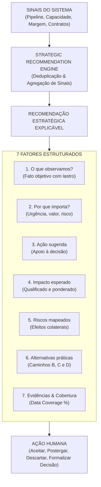

# VELLIA LICITAÇÕES — RELATÓRIO EXECUTIVO OFICIAL
## FASE 57 — STRATEGIC RECOMMENDATION ENGINE + RECOMENDAÇÕES EXECUTIVAS EXPLICÁVEIS

---

### SUMÁRIO EXECUTIVO
A **Fase 57** introduz o **Strategic Recommendation Engine (Motor de Recomendações Estratégicas)** no **Vellia Licitações**, estabelecendo uma camada de inteligência prescritiva transparente, rastreável e rigorosamente orientada ao apoio à decisão executiva.

O princípio central inviolável desta fase é:
> **Recomendação NÃO é decisão.**
> Toda recomendação é formulada como: **"Ação sugerida com base nos dados atuais"**, jamais como imposição autoritária (*"Faça isso"*). O sistema não atua como um "oráculo", mas sim como um assessor estratégico explicável que expõe evidências, alternativas e trade-offs para a deliberação humana.

---

### 1. AS SETE DIMENSÕES EXPLICÁVEIS DE CADA RECOMENDAÇÃO

1. **O que observamos?** Constatação fatual objetiva (ex: prazo em 72h, aderência de 94%, BDI sem aprovação).
2. **Por que importa?** Exposição da relevância executiva e das consequências da inércia.
3. **O que sugerimos avaliar?** Proposição clara de ação preventiva ou corretiva.
4. **Qual o impacto esperado?** Benefício estimado no certame, na margem ou na segurança jurídica.
5. **Quais são os riscos?** Riscos associados tanto à ação quanto à omissão.
6. **Quais alternativas existem?** Múltiplos caminhos possíveis (compra, locação, subcontratação homologada, repactuação de prazo).
7. **Qual evidência sustenta isso?** Vínculo canônico com oportunidades, contratos, cotações, snapshots de cenários e cobertura de dados (`Data Coverage %`).

---

### 2. AGREGAÇÃO DE SINAIS E DETECÇÃO DE COLISÕES
- **Agregação de Sinais (Signal Aggregation):** O motor consolida múltiplos sinais afins (prazo curto + alçada pendente + pendência documental) em uma **única recomendação integrada**, eliminando o ruído de múltiplos alertas desconexos.
- **Detecção de Colisões (Trade-offs Concorrentes):** Quando duas recomendações apontam para direções opostas (exemplo: recomendação para acelerar expansão em novos certames vs alerta de sobrecarga crítica da equipe de campo), o sistema sinaliza explicitamente o conflito de trade-off e direciona para simulação no **Strategic Scenario Lab (Fase 56)**.

---

### 3. CICLO DE VIDA E VÍNCULO COM A MEMÓRIA ESTRATÉGICA (FASE 55)
- **Ações Humanas Disponíveis:**
  - `Aceitar (Accept):` Não executa ações em lote automaticamente; encaminha a sugestão para a criação de tarefa, iniciativa estratégica ou simulação.
  - `Postergar (Defer):` Permite reagendar a análise para data futura (ex: após emissão de nova cotação).
  - `Descartar (Dismiss):` Exige justificativa formal controlada (`Estratégia da Diretoria`, `Já Endereçado`, `Dados Divergentes`, etc.), com preenchimento obrigatório para itens classificados como **Críticos**.
  - `Formalizar Decisão Estratégica:` Converte a recomendação aceita em uma **Decisão Canônica na Memória Estratégica (Fase 55)** através do método `convertToStrategicDecision()`, vinculando snapshot, premissas e justificativa auditável.

---

### 4. COPILOT DE RECOMENDAÇÕES ESTRATÉGICAS
O Copilot Executivo responde consultas como:
- *"O que você recomenda revisar hoje com prioridade?"*
- *"Quais gargalos de capacidade merecem atenção?"*
- *"Quais recomendações de margem e precificação estão ativas?"*

Todas as respostas adotam o formato explicável: **Observação + Ação Sugerida + Evidência + Alternativas + Riscos**, sem jamais utilizar tom imperativo.

---

### 5. VALIDAÇÃO DOS TESTES DE ESPECIFICAÇÃO

| Teste | Cenário Avaliado | Resultado do Sistema |
|---|---|---|
| **Teste 1** | Recomendação sem imperativo. | Formulada estritamente como "Ação sugerida com base nos dados atuais". |
| **Teste 2** | Sinais múltiplos da mesma oportunidade. | Agrupados em uma única recomendação coerente sem duplicações. |
| **Teste 3** | Conflito de Expansão vs Capacidade. | Banner de colisão exibido com atalho para simulação no Scenario Lab. |
| **Teste 4** | Recomendação Crítica descartada. | Sistema exige justificativa formal de ao menos 10 caracteres. |
| **Teste 5** | Conversão em Decisão. | Vínculo e snapshot gerados na Memória Estratégica (Fase 55); status vira `IMPLEMENTED`. |
| **Teste 6** | Dados com baixa cobertura de custos. | Tag explícita exibindo "Cobertura de Dados: 75%". |
| **Teste 7** | Acesso sem permissão financeira. | Recomendações de margem e pricing mantidas sob sigilo por alçada. |
| **Teste 8** | Multiempresa (Veeluen vs Excelência). | Recomendações segmentadas por empresa ou visualizadas no Grupo sem contaminação. |
| **Teste 9** | Copilot em linguagem explicável. | Resposta estruturada sem ordens imperativas nem inventar dados. |
| **Teste 10** | Responsividade Mobile. | Layout adaptado com leitura fluida dos 7 fatores essenciais no smartphone. |

---

### 6. ARQUIVOS IMPLEMENTADOS E CONECTADOS
1. [strategicRecommendationEngine.js](file:///c:/Users/USU%C3%81RIO/OneDrive/%C3%81rea%20de%20Trabalho/OneDrive/Documentos/Vellia%20Licita%C3%A7%C3%B5es/src/services/strategic/strategicRecommendationEngine.js)
2. [StrategicRecommendationsView.jsx](file:///c:/Users/USU%C3%81RIO/OneDrive/%C3%81rea%20de%20Trabalho/OneDrive/Documentos/Vellia%20Licita%C3%A7%C3%B5es/src/components/recommendations/StrategicRecommendationsView.jsx)
3. [StrategicRecommendationsView.css](file:///c:/Users/USU%C3%81RIO/OneDrive/%C3%81rea%20de%20Trabalho/OneDrive/Documentos/Vellia%20Licita%C3%A7%C3%B5es/src/components/recommendations/StrategicRecommendationsView.css)
4. [Sidebar.jsx](file:///c:/Users/USU%C3%81RIO/OneDrive/%C3%81rea%20de%20Trabalho/OneDrive/Documentos/Vellia%20Licita%C3%A7%C3%B5es/src/components/Sidebar.jsx)
5. [App.jsx](file:///c:/Users/USU%C3%81RIO/OneDrive/%C3%81rea%20de%20Trabalho/OneDrive/Documentos/Vellia%20Licita%C3%A7%C3%B5es/src/App.jsx)

---

### 7. CONCLUSÃO
A **Fase 57** conclui a entrega do **Strategic Recommendation Engine**, garantindo que a inteligência artificial e os dados analíticos do Vellia operem como uma assessoria estratégica explicável, transparente e estritamente subordinada à liderança humana.
