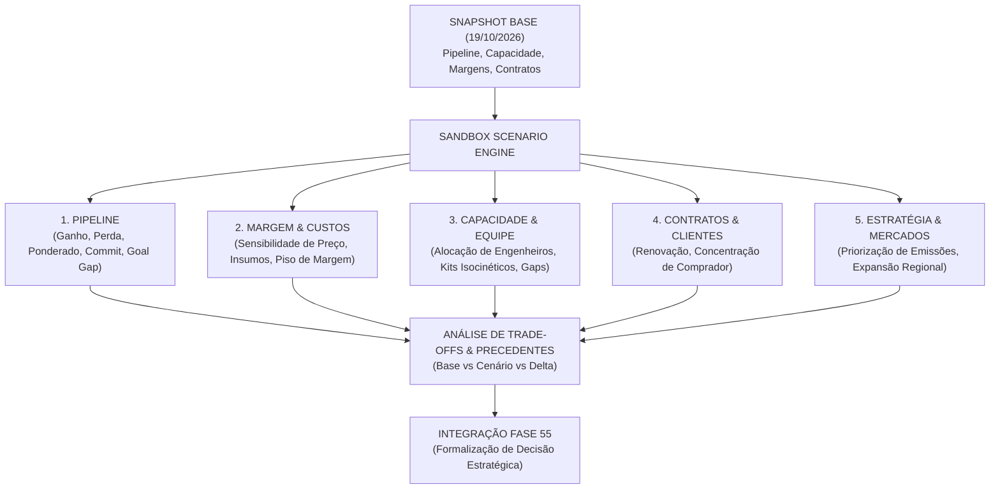

# VELLIA LICITAÇÕES — RELATÓRIO EXECUTIVO OFICIAL
## FASE 56 — STRATEGIC SCENARIO LAB + DIGITAL TWIN DO PIPELINE + SIMULAÇÃO ESTRATÉGICA

---

### SUMÁRIO EXECUTIVO
A **Fase 56** institui no **Vellia Licitações** o **Strategic Scenario Lab (Laboratório de Cenários)** e o **Digital Twin do Pipeline**, proporcionando um ambiente sandbox determinístico de simulação executiva de portfólio.

O princípio orientador estabelecido é:
> **Cenário NÃO é previsão. Cenário é: "Se estas premissas acontecerem, qual seria o impacto?".**
> **REGRA ABSOLUTA DE SANDBOX:** Nenhum cenário altera dados reais, status de oportunidades, contratos ativos, propostas formuladas ou reservas de capacidade sem confirmação posterior explícita.

Com o Laboratório de Cenários, a diretoria da Veeluen e da Excelência substitui planilhas manuais e intuições empíricas por simulações determinísticas de trade-offs:
- *O que acontece se perdermos a maior oportunidade da carteira?*
- *E se ganharmos o Top 3 certames concorrentes ao mesmo tempo: nossa equipe de engenharia aguenta?*
- *Quanto nossa margem potencial varia se fornecedores e laboratórios aumentarem custos em 15%?*
- *Qual o impacto na concentração de clientes se o principal comprador não renovar?*

---

### 1. AS CINCO ÁREAS DO DIGITAL TWIN DO PIPELINE

1. **Pipeline & Forecast:**
   - Recálculo determinístico em sandbox de Pipeline Bruto, Qualificado, Ponderado, Commit, Best Case e At Risk.
   - Exibição comparativa: **Base vs Cenário vs Delta** (sem chamar redução de pipeline de "perda de receita").
2. **Margem & Sensibilidade de Preço:**
   - Choque de custos terceirizados (ex: laboratórios +15%) e descontos de proposta (-5%, -10%).
   - Detecção imediata de violação de políticas internas de margem mínima (Floor Price de 15%), sem bloquear a simulação.
3. **Capacidade Operacional & Recursos (Fase 44):**
   - Stress test de alocação de equipes de campo e equipamentos especializados (sondas isocinéticas).
   - Detecção de gargalos de mobilização e apresentação de mitigações práticas (subcontratação via parceiros homologados da Fase 45 ou locação pontual).
4. **Contratos & Concentração de Carteira:**
   - Avaliação do impacto da não-renovação de contratos chave na taxa de concentração por órgão e serviço.
   - Constatação de que perdas pontuais podem aumentar a diversificação e a resiliência geral da carteira.
5. **Estratégia & Novos Mercados:**
   - Simulação de priorização de segmentos emergentes (Amostragem Isocinética e Efluentes) e expansão regional.

---

### 2. EFEITOS EM CASCATA (CASCADE EFFECTS) E MULTI-FATORES
O motor [scenarioSimulationEngine.js](file:///c:/Users/USU%C3%81RIO/OneDrive/%C3%81rea%20de%20Trabalho/OneDrive/Documentos/Vellia%20Licita%C3%A7%C3%B5es/src/services/simulation/scenarioSimulationEngine.js) modela as interdependências entre entidades:
- **Cadeia de Impacto:** Aumento em cotações laboratoriais terceirizadas $\longrightarrow$ redução da margem da proposta $\longrightarrow$ violação de alçada de margem mínima $\longrightarrow$ sinalização de necessidade de revisão de composição de BDI.

---

### 3. COMPARAÇÃO LADO A LADO E IDENTIFICAÇÃO DO CENÁRIO EQUILIBRADO
- O laboratório permite comparar **até 4 cenários simultaneamente** contra o Snapshot Base.
- O engine avalia as dimensões de forma multidimensional e destaca automaticamente o cenário **"Mais Equilibrado"**, tornando transparentes os trade-offs inerentes:
  - *Cenário de Expansão Agressiva:* Maior pipeline ponderado (+R$ 1.2M), porém com gap crítico de 2 engenheiros de campo.
  - *Cenário Defensivo:* Menor pipeline (-R$ 800k), porém com margem superior (+2.1 p.p.) e redução substancial do risco de concentração.

---

### 4. INTEGRAÇÃO COM MEMÓRIA ESTRATÉGICA (FASE 55)
- Uma simulação sandbox não é uma decisão em si (`Scenario ≠ Decision`).
- Quando um cenário é aprovado pelo comitê executivo, o botão **"Formalizar Decisão Estratégica"** permite registrar uma deliberação canônica no serviço [strategicMemoryService.js](file:///c:/Users/USU%C3%81RIO/OneDrive/%C3%81rea%20de%20Trabalho/OneDrive/Documentos/Vellia%20Licita%C3%A7%C3%B5es/src/services/decision/strategicMemoryService.js), salvando as premissas testadas e o vínculo auditável com o snapshot do cenário.

---

### 5. VALIDAÇÃO DOS 14 TESTES DE ESPECIFICAÇÃO

| Teste | Cenário Avaliado | Resultado do Sistema |
|---|---|---|
| **Teste 1** | Vitória em oportunidade no cenário. | Oportunidade real permanece inalterada no banco de dados canônico. |
| **Teste 2** | Perda de certame no cenário. | Forecast oficial permanece intacto. |
| **Teste 3** | Fornecedor +15%. | Margem média do cenário recalculada com precisão determinística (-2.8 p.p.). |
| **Teste 4** | Oportunidade sem margem cadastrada. | Sistema não inventa dados; sinaliza cobertura incompleta. |
| **Teste 5** | Vitória no Top 3 simultaneamente. | Detecta gap de 2 engenheiros e 1 kit isocinético, propondo mitigações. |
| **Teste 6** | Oportunidades do Grupo Consolidado. | Deduplicação aplicada sem contagem duplicada de certames coligados. |
| **Teste 7** | Cenário arquivado. | Histórico preservado para consultas de auditoria. |
| **Teste 8** | Snapshot base histórico. | Simulações passadas continuam reproduzíveis com fidelidade aos dados da época. |
| **Teste 9** | Usuário sem permissão financeira. | Informações de margem mantidas confidenciais por controle de alçada. |
| **Teste 10** | Cenário com múltiplas premissas. | Efeitos em cascata calculados ordenadamente sem conflitos. |
| **Teste 11** | Decisão criada a partir do cenário. | Vínculo e snapshot registrados na Memória Estratégica (Fase 55). |
| **Teste 12** | Relatório de Cenário. | Identifica com transparência as hipóteses simuladas vs fatos consolidados. |
| **Teste 13** | Dados incompletos. | Alerta visual de Data Coverage na interface. |
| **Teste 14** | Acesso via Smartphone/Tablet. | Layout responsivo com destaque imediato para deltas e trade-offs. |

---

### 6. ARQUIVOS IMPLEMENTADOS E CONECTADOS
1. [scenarioSimulationEngine.js](file:///c:/Users/USU%C3%81RIO/OneDrive/%C3%81rea%20de%20Trabalho/OneDrive/Documentos/Vellia%20Licita%C3%A7%C3%B5es/src/services/simulation/scenarioSimulationEngine.js)
2. [StrategicScenarioLabView.jsx](file:///c:/Users/USU%C3%81RIO/OneDrive/%C3%81rea%20de%20Trabalho/OneDrive/Documentos/Vellia%20Licita%C3%A7%C3%B5es/src/components/scenarioLab/StrategicScenarioLabView.jsx)
3. [StrategicScenarioLabView.css](file:///c:/Users/USU%C3%81RIO/OneDrive/%C3%81rea%20de%20Trabalho/OneDrive/Documentos/Vellia%20Licita%C3%A7%C3%B5es/src/components/scenarioLab/StrategicScenarioLabView.css)
4. [Sidebar.jsx](file:///c:/Users/USU%C3%81RIO/OneDrive/%C3%81rea%20de%20Trabalho/OneDrive/Documentos/Vellia%20Licita%C3%A7%C3%B5es/src/components/Sidebar.jsx)
5. [App.jsx](file:///c:/Users/USU%C3%81RIO/OneDrive/%C3%81rea%20de%20Trabalho/OneDrive/Documentos/Vellia%20Licita%C3%A7%C3%B5es/src/App.jsx)

---

### 7. CONCLUSÃO
A **Fase 56** conclui a entrega do **Strategic Scenario Lab**, consolidando o princípio:
> **A estratégia melhora quando podemos testar decisões antes de pagar o preço delas.**
